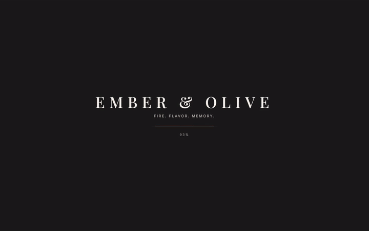
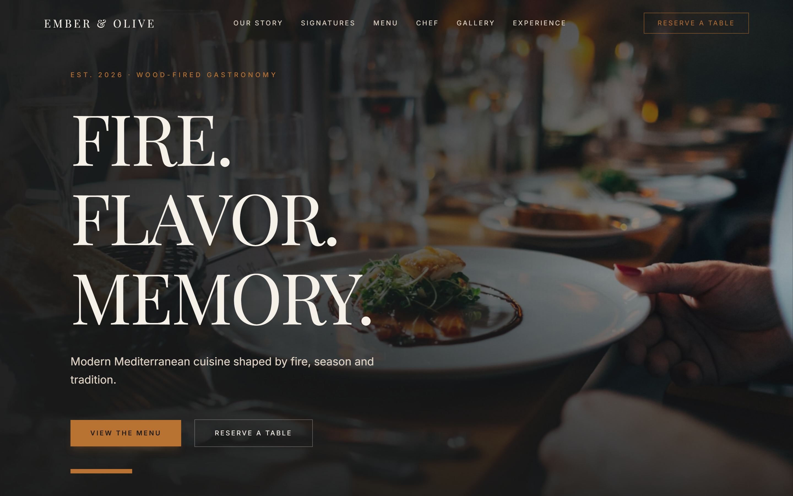
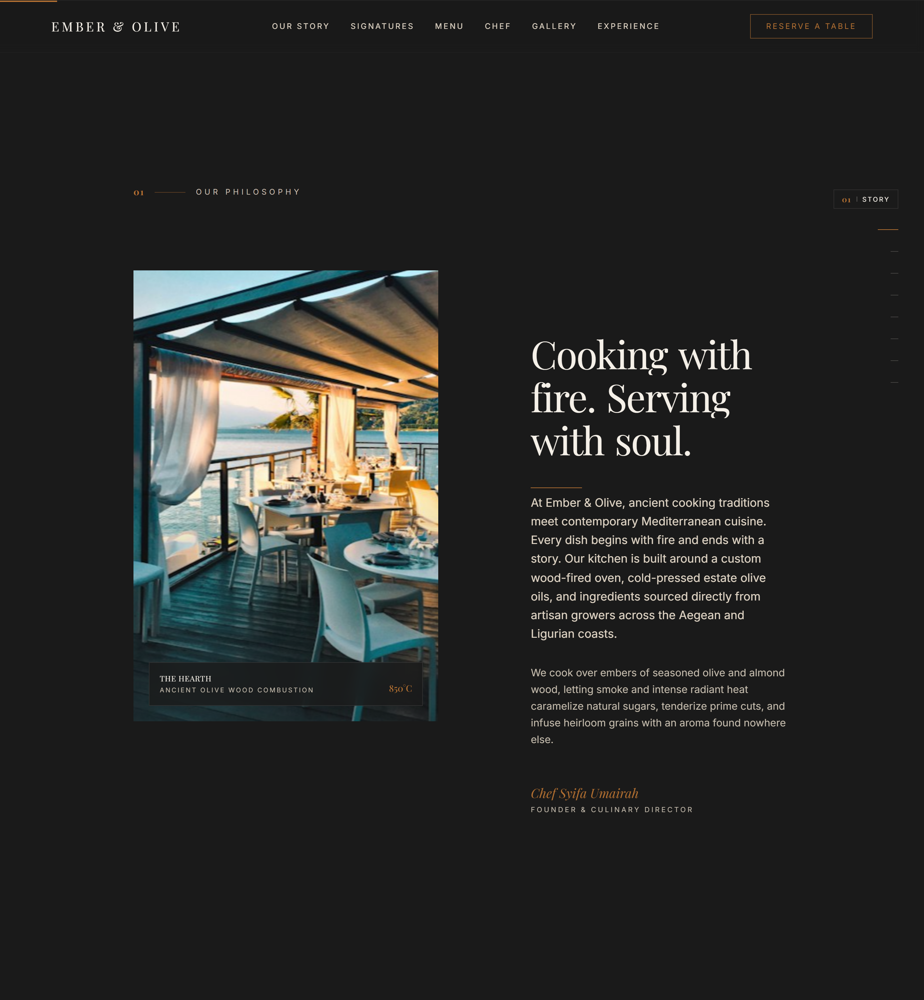
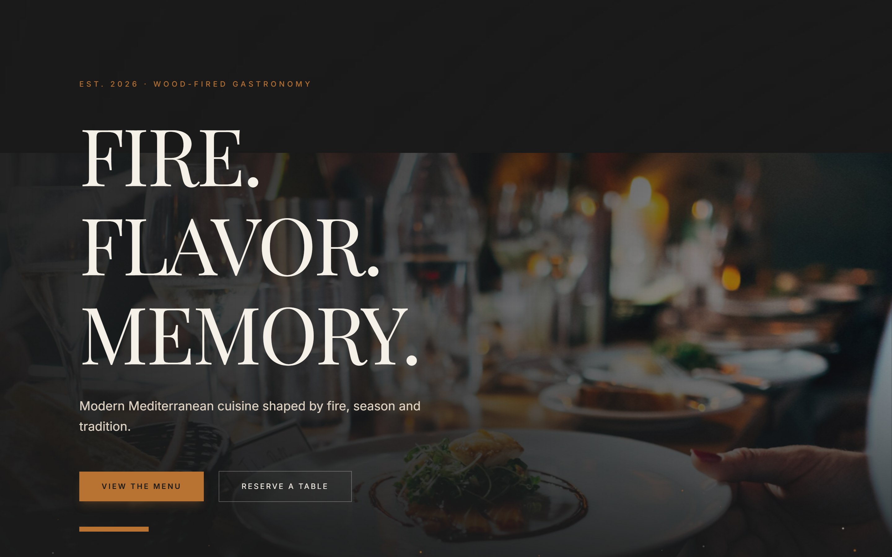
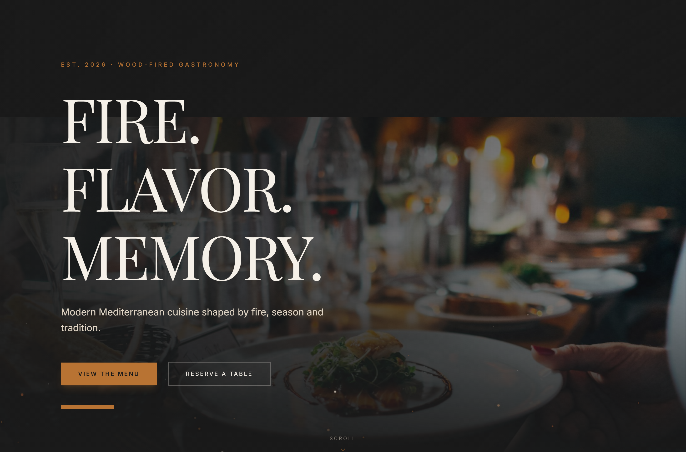
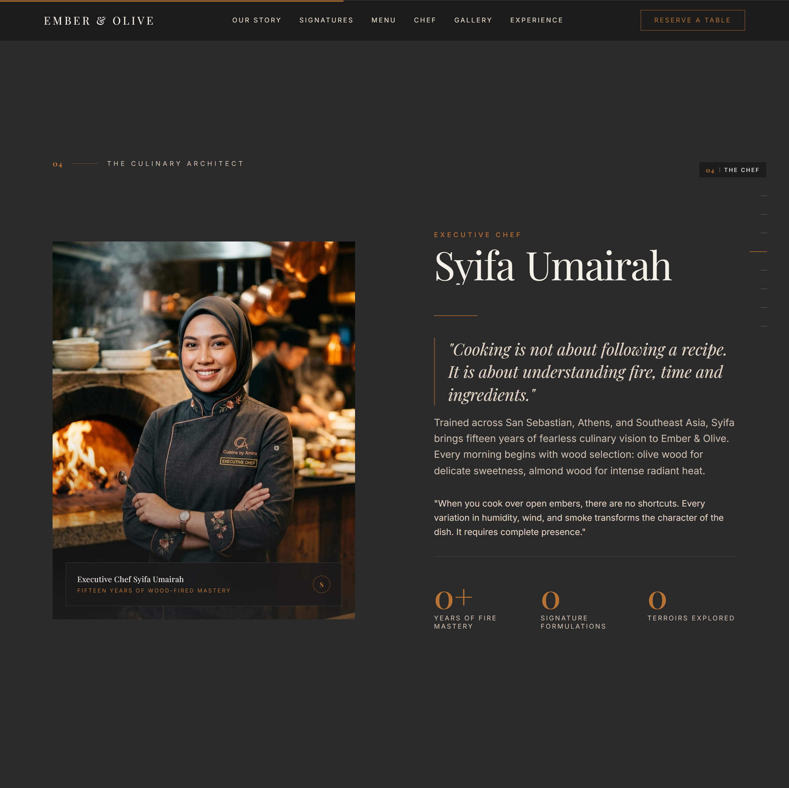

# Ember & Olive

> Modern Mediterranean wood-fired gastronomy web experience crafted with React 19, TypeScript, Tailwind CSS v4, and GSAP ScrollTrigger animations.

[](https://react.dev/)
[](https://www.typescriptlang.org/)
[](https://vitejs.dev/)
[](https://tailwindcss.com/)
[](https://gsap.com/)
[](https://ember-olive.harisharraz02.workers.dev)

> **Live Preview**: [https://ember-olive.harisharraz02.workers.dev](https://ember-olive.harisharraz02.workers.dev)

---

## Screen Recording & Interactive Walkthrough

A complete 30-second smooth scroll recording capturing the cinematic loading screen, hero entrance, scroll reveals, interactive menu drawer with sommelier pairing cards, and Chef Syifa Umairah section:

[](docs/ember-olive-demo.mp4)

> **Watch Full HD Video**: [Download or view docs/ember-olive-demo.mp4](docs/ember-olive-demo.mp4) (H.264, 30fps, 1440x900).

---

## Visual Showcase

### 01. The Cinematic Hero
Editorial landing section featuring Playfair Display typography, warm atmospheric ember lighting, parallax scroll depth, and immediate table reservation calls to action.



---

### 02. Culinary Philosophy & The Wood-Fired Hearth
Editorial layout detailing our heritage: olive and almond wood combustion, cold-pressed estate olive oils, and ancient hearth techniques. Features dual-clip path reveals and synchronized typography stagger.



---

### 03. Signature Hearth Offerings
Curated culinary showcases spanning wood-grilled Mediterranean octopus, dry-aged Florentine bistecca, and wild mushroom risotto. High-resolution dish photography paired with 3D perspective hover cards and subtle index watermarks.



---

### 04. Interactive Menu Drawer & Sommelier Pairings
Dynamic multi-category gastronomy menu (Starters, Mains, From the Grill, Pasta & Risotto, Desserts, Cellar). Hovering or focusing on any dish triggers an accordion drawer revealing high-resolution dish photography, ingredient badges, culinary preparation notes, and recommended sommelier pairings with natural wines.



---

### 05. Executive Chef Syifa Umairah
Portrait of Executive Chef Syifa Umairah at the wood-fired hearth. Features interactive 3D perspective mouse-tilt physics, clip-path mask reveals, and live counter telemetry (15+ Years of Mastery, 48 Signature Formulations, 12 Terroirs Explored).



---

### 06. Table Reservations & Concierge
Online reservation request form with animated floating labels, field focus transitions, instant client validation, and real-time confirmation states.


---

## Architectural Highlights

- **React 19 & TypeScript**: Strict type safety across all dish schemas, sommelier pairings, wine terroirs, and layout components.
- **GSAP & ScrollTrigger Pipeline**: Scrubbed parallax layers, letter-by-letter split text reveals, clip-path image masks, and counter increments.
- **Tailwind CSS v4 Engine**: Built on the modern `@tailwindcss/vite` pipeline using custom color tokens (`charcoal #1a1a1a`, `cream #f5f0e8`, `copper #b87333`, and `olive #4b5320`).
- **Interactive Dish Drawers**: CSS grid interpolation (`grid-template-rows: 0fr -> 1fr`) with zero layout reflow jumps.
- **Curated Sommelier Cellar**: Dedicated natural wine selector matched to smoke profiles, oak aging, and acid levels.
- **Accessible & Responsive**: WCAG AA contrast ratios, screen-reader friendly aria tags, and full touch device support.

---

## Project Structure

```
ember-olive/
├── docs/
│   └── screenshots/         # High-resolution application screenshots
├── scripts/
│   └── take-screenshots.mjs # Automated Puppeteer capture script
├── src/
│   ├── animations/          # GSAP configuration and custom scroll triggers
│   ├── assets/              # Curated photography and chef portrait
│   ├── components/
│   │   ├── Chef.tsx         # Executive Chef section with 3D mouse tilt
│   │   ├── Experience.tsx   # Dining atmospheres and cellar showcase
│   │   ├── Footer.tsx       # Brand links, social navigation, and hours
│   │   ├── Gallery.tsx      # Masonry photo gallery with modal lightbox
│   │   ├── Hero.tsx         # Full-viewport cinematic landing
│   │   ├── Intro.tsx        # Philosophy and wood-fired oven focus
│   │   ├── Lightbox.tsx     # Fullscreen image viewer with keyboard navigation
│   │   ├── LoadingScreen.tsx# Cinematic branded intro sequence
│   │   ├── Location.tsx     # Hours, directions, and venue address
│   │   ├── Menu.tsx         # Interactive menu with hover ingredient drawers
│   │   ├── Navbar.tsx       # Scroll-aware blur header with mobile overlay
│   │   ├── Reservation.tsx  # Table request form with floating labels
│   │   ├── SignatureDishes.tsx # Two-column unclipped dish showcase
│   │   ├── SommelierDrawer.tsx # Slide-out cellar wine archive
│   │   ├── SplitTextReveal.tsx # Staggered text entrance utility
│   │   └── Testimonials.tsx # Guest review carousel with auto-advance
│   ├── data/
│   │   ├── dishes.ts        # Signature dish records and descriptions
│   │   ├── experiences.ts   # Private dining and chef table packages
│   │   ├── gallery.ts       # Photography gallery registry
│   │   ├── menu.ts          # Complete restaurant menu records
│   │   ├── testimonials.ts  # Critic and patron reviews
│   │   └── wines.ts         # Natural Mediterranean wine pairings
│   ├── hooks/
│   │   └── usePrefersReducedMotion.ts # Motion accessibility hook
│   ├── App.tsx              # Application layout root
│   ├── index.css            # Custom fonts and Tailwind v4 theme directives
│   └── main.tsx             # DOM mounting entry
├── package.json
├── tsconfig.json
└── vite.config.ts
```

---

## Getting Started

### Prerequisites
- Node.js 18.0 or higher
- npm 9.0 or higher

### Installation

1. Clone the repository:
   ```bash
   git clone https://github.com/risterz/ember-olive.git
   cd ember-olive
   ```

2. Install dependencies:
   ```bash
   npm install
   ```

3. Start the local development server:
   ```bash
   npm run dev
   ```

4. Open your browser and navigate to `http://localhost:5173`.

---

## Available Scripts

| Command | Action |
| :--- | :--- |
| `npm run dev` | Starts the Vite development server with Hot Module Replacement |
| `npm run build` | Runs TypeScript compilation and builds for production into `dist/` |
| `npm run preview` | Locally preview the production build |
| `npm run screenshots` | Runs the headless browser script to capture visual assets |
| `npm run record` | Automates browser tour and records MP4 screen walkthrough via FFmpeg |
| `npm run deploy` | Deploys static build to Cloudflare Workers with Static Assets via Wrangler |

---

## Design System & Color Palette

- **Charcoal (`#1a1a1a`)**: Foundation base for high-contrast culinary photography.
- **Charcoal Light (`#2a2a2a`)**: Elevated surfaces and card containers.
- **Cream (`#f5f0e8`)**: Primary editorial typography and delicate borders.
- **Cream Muted (`#c8bfb0`)**: Secondary descriptions and dish metadata.
- **Copper (`#b87333`)**: Warm hearth accents, active indicators, and primary CTAs.
- **Olive (`#4b5320`)**: Dietary tags and subtle botanical highlights.

---

## License

Private project developed for Ember & Olive Wood-Fired Gastronomy. All rights reserved.
